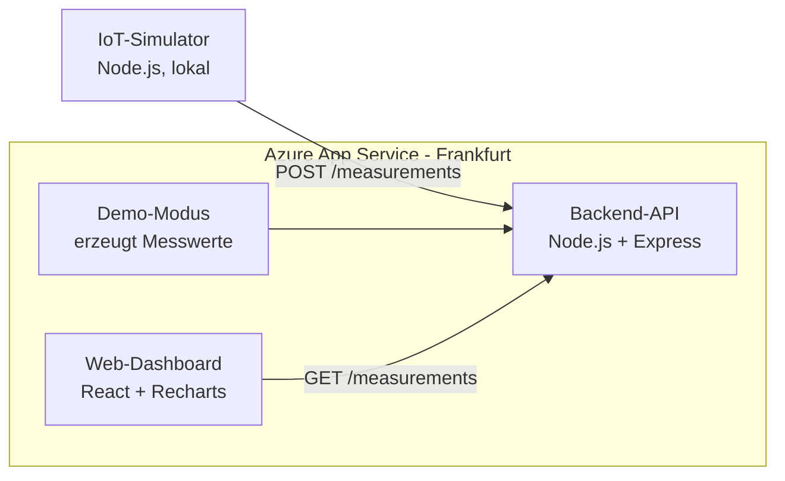

# H2 Plant Monitor

**Live-Demo:** https://h2-plant-monitor-api-abdullah.azurewebsites.net
*(beim ersten Aufruf nach längerer Pause ca. 30 Sekunden Ladezeit)*

Live-Monitoring-Dashboard für einen simulierten Elektrolyseur, also eine Anlage, die aus Strom Wasserstoff herstellt.

Ein Simulator erzeugt laufend Messwerte (Stromverbrauch, H2-Produktion, Temperatur), eine Node.js-API speichert sie, und ein React-Dashboard zeigt sie live an. Eine einfache Anomalie-Erkennung warnt, wenn die Effizienz der Anlage auffällig schlechter wird.

## Architektur



Online erzeugt die API im **Demo-Modus** selbst Messwerte, damit das Dashboard jederzeit Live-Daten zeigt. Lokal kann stattdessen der separate Simulator Daten senden.

## Tech-Stack

| Baustein | Technologie |
|---|---|
| Simulator | Node.js |
| Backend-API | Node.js, Express |
| Dashboard | React, Vite, Recharts |
| Cloud | Microsoft Azure App Service (Region Germany West Central) |
| Versionsverwaltung | Git, GitHub |

## Features

- Simulierte Messwerte alle 3 Sekunden, inklusive zufälliger Störungen
- REST-API mit `POST /measurements` und `GET /measurements`
- Live-Diagramme für H2-Produktion, Stromverbrauch und Effizienz (kWh pro kg H2)
- Warnung bei auffälliger Effizienz (Schwellenwert: 60 kWh/kg, normal ca. 55)
- Cloud-Deployment auf Azure mit Demo-Modus über die Umgebungsvariable `DEMO_MODE`

## Lokal starten

Voraussetzung: Node.js (LTS)

Drei Terminals, in dieser Reihenfolge:

```bash
# 1. API
cd api
npm install
node server.js

# 2. Simulator
cd simulator
node simulate.js

# 3. Dashboard
cd dashboard
npm install
npm run dev
```

Dashboard öffnen: http://localhost:5173

## Roadmap

- [x] Phase 1: Simulator, API und Dashboard lokal
- [x] Phase 2a: API und Dashboard auf Azure, Demo-Modus
- [ ] Phase 2b: Datenbank auf Azure, Power-BI-Bericht
- [ ] Phase 3: Anomalie-Erkennung mit Machine Learning